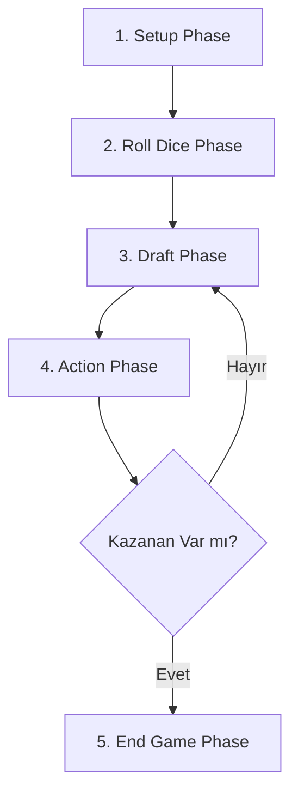

# ♟️ Project Chess: Tactical Hex-Grid Strategy & Deckbuilder

[](https://unity.com/)
[](https://docs.microsoft.com/en-us/dotnet/csharp/)
[](https://unity.com/products/netcode-for-gameobjects)
[](https://partner.steamgames.com/)
[](LICENSE)

**Project Chess**, geleneksel satranç dinamiklerini altıgen (hexagonal) ızgara tabanlı alan kontrolü, stratejik kart draft etme (kart toplama), sinerji sistemleri, gelişmiş AI bot simülasyonları ve Steam destekli çok oyunculu (multiplayer) mimari ile harmanlayan yenilikçi bir 3D taktik strateji oyunudur.

Unity 6 motoru üzerinde yükselen bu proje; modüler C# yapısı, Netcode for GameObjects ile sağlanan sunucu yetkili (server-authoritative) ağ mimarisi, procedural kart üretimi ve gelişmiş UI/VFX efektleri ile eksiksiz bir oyun deneyimi sunar.

---

## 📌 İçindekiler
- [Öne Çıkan Özellikler](#-öne-çıkan-özellikler)
- [Oyun Mekanikleri ve Akışı](#-oyun-mekanikleri-ve-akışı)
- [Taş (Pawn) ve Sınıf Sistemleri](#-taş-pawn-ve-sınıf-sistemleri)
- [Kart, Draft ve Fusion Sistemi](#-kart-draft-ve-fusion-sistemi)
- [Yapay Zeka & Bot Simülasyonu](#-yapay-zeka--bot-simülasyonu)
- [Çok Oyunculu Ağ Mimarisi & Steam Entegrasyonu](#-çok-oyunculu-ağ-mimarisi--steam-entegrasyonu)
- [Çoklu Dil Desteği (Localization)](#-çoklu-dil-desteği-localization)
- [Teknoloji Yığını ve Paketler](#-teknoloji-yığını-ve-paketler)
- [Proje Klasör Yapısı](#-proje-klasör-yapısı)
- [Kurulum ve Çalıştırma](#-kurulum-ve-çalıştırma)
- [Katkıda Bulunma ve İletişim](#-katkıda-bulunma-ve-iletişim)

---

## ✨ Öne Çıkan Özellikler

- **📐 Altıgen Izgara (Flat-Top Hex Grid):** 10x11 boyutlarında matematiksel olarak hizalanmış, dinamiğe dayalı yol bulma ve engel yönetimi sunan altıgen harita sistemi.
- **🃏 Prosedürel Kart Desteği (120 Kartlık Deck):** Tohumlanan (seeded) rastgele kart üretimi, sınıfa özel Buff/Debuff mantığı ve kart birleştirme (Fusion) mekanizması.
- **🤝 Sinerji & Aura Sistemleri:** Sahada aynı gruptan taşların kombinasyonuna göre tetiklenen dinamik buff'lar ve etrafındaki müttefikleri güçlendiren Aura efektleri.
- **🤖 Server-Authoritative Bot AI:** Kart değerlendirme (Keep/Give/Burn), ağırlıklı güç hesabı (Damage/HP) ve taktiki pozisyon alma yeteneğine sahip gelişmiş yapay zeka.
- **📊 Otomatik Bot Match Reporter & Python Analiz Betiği:** Bot vs Bot maçlarını XML formatında kaydeden telemetry altyapısı ve galibiyet oranlarını analiz eden Python betiği (`analyze_reports.py`).
- **🌐 Unity Netcode & Steam Entegrasyonu:** Unity Relay/Lobby altyapısı ve Steamworks üzerinden doğrudan Steam arkadaş davetleri (Lobby ID entegrasyonu).
- **🌍 Çoklu Dil Desteği (Localization):** İngilizce, Almanca, Fransızca, Portekizce ve İspanyolca olmak üzere 5 farklı dil desteği.
- **✨ Görsel ve İşitsel Şölen:** DOTween animasyonları, MoreMountains Feel & NiceVibrations dokunsal/görsel geribildirimleri, dynamic 3D kartlar ve özel particle/VFX paketleri.

---

## 🎮 Oyun Mekanikleri ve Akışı

Oyunda bir maç 5 ana evreden oluşur (`GameManager.cs` tarafından yönetilir):



1. **Setup Phase (Hazırlık Evresi):** Oyuncular stratejilerine uygun taş gruplarını seçer ve altıgen harita üzerindeki başlangıç alanlarına yerleştirir.
2. **Roll Dice Phase (Zar Atışı):** İlk hamleyi kimin yapacağını belirlemek için sunucu senkronize zar atışı gerçekleştirir.
3. **Draft Phase (Kart Seçimi):** Oyuncular rastgele çekilen kartlar arasından seçim yapar. Kartları saklayabilir (Keep), rakibe devredebilir (Give), yakabilir (Burn) veya kart birleştirme (Fusion) yapabilirler.
4. **Action Phase (Aksiyon Evresi):** Oyuncular ellerindeki kartları oynayarak taşlarını hareket ettirir, özel yetenekleri tetikler, engeller koyar ve rakip taşlara saldırır.
5. **End Game Phase (Oyun Sonu):** Bir oyuncunun tüm taşları elendiğinde veya skor üstünlüğü elde edildiğinde maç biter. Her iki oyuncunun onayı ile maç yeniden başlatılabilir (Restart).

---

## ♟️ Taş (Pawn) ve Sınıf Sistemleri

Oyunda her biri kendine özgü istatistiklere, saldırı kalıplarına ve ses/VFX efektlerine sahip **9 benzersiz Taş Sınıfı** bulunmaktadır (`PawnData.cs`):

| Sınıf (Pawn Type) | Özel Yetenekler & Özellikler |
| :--- | :--- |
| **🏹 Archer (Okçu)** | Uzak mesafeden hedef alma ve menzilli saldırı kalıpları. |
| **💣 Cannon (Topçu)** | Alan etkili (AoE) patlama hasarı ve düsen hasar yarıçapı (Damage Falloff). |
| **🛡️ Knight (Şövalye)** | Yüksek can havuzu ve ön hat koruma yetenekleri. |
| **👑 Queen (Vezir)** | Geniş hareket ve yüksek saldırı kapasitesi. |
| **🐎 Horseman (Süvari)** | Engellerin üzerinden atlayabilen esnek altıgen hareket kalıbı. |
| **🎖️ Commander (Komutan)** | Çevresindeki müttefik taşlara bonus hasar ve can sağlayan **Aura** yeteneği. |
| **🥷 Ninja (Ninja)** | Kritik sızma hareketleri ve yüksek anlık hasar. |
| **🤠 Cheriff (Şerif)** | Dengeli mesafe ve kontrol yetenekleri. |
| **🧙 Wizard (Büyücü)** | Müttefik birimleri iyileştirme (**Healer**) ve dinamik alan buff'ları. |

---

## 🃏 Kart, Draft ve Fusion Sistemi

- **Dinamik Buff & Debuff İğnelemesi:** `DeckManager`, 120 kartlık desteyi oluştururken sınıfa özel Buff'lar ve küresel Debuff'lar üretir. Kart, ait olduğu sınıfta oynandığında %100 etki ederken, eşleşmeyen bir sınıfta oynandığında düşürülmüş etki veya farklı bir hareket kalıbı (Mismatch Pattern) uygular.
- **Engelleme Kartları (Obstacle Cards):** Sadece taş hareketi değil, haritaya dinamik 3 boyutlu engeller (`ObstaclePattern`) koyarak rakibin yolunu kapatma olanağı sunar.
- **Kart Birleştirme (Fusion System):** Oyuncular ellerindeki kartları birleştirerek daha güçlü kombinasyonlar üretebilir (`FusionUI.cs`). Şanslarını beğenmezlerse Re-Roll haklarını kullanabilirler.

---

## 🤖 Yapay Zeka & Bot Simülasyonu

Proje, tek oyunculu testler ve dengeleme simülasyonları için tamamen sunucu taraflı çalışan gelişmiş bir **Bot AI** altyapısına sahiptir (`BotAIController.cs`):

- **Kart Değerlendirme Algoritması:** Bot, elindeki kartların taş sınıfları ile uyumunu hesaplar (%100 buff vs %50 mismatch etki).
- **Taktik Yol Bulma & Saldırı:** Hasar/Sağlık ağırlık çarpanlarına göre en yüksek puanlı hamleleri önceliklendirir.
- **Telemetry ve Analiz (BotVsBotReports):** Yapay zeka maçlarının tüm detayları `%LOCALAPPDATA%Low/DefaultCompany/Project_Chess/BotVsBotReports` dizinine XML formatında kaydedilir.

### 🐍 Python İstatistik Analiz Betiği (`analyze_reports.py`)

Kök dizinde yer alan Python script'i sayesinde son oynanan bot maçlarının kazanan oranları ve tercih edilen taş kombinasyonları anında analiz edilebilir:

```bash
python analyze_reports.py
```

---

## 🌐 Çok Oyunculu Ağ Mimarisi & Steam Entegrasyonu

Project Chess, güvenilir bir multiplayer tecrübesi sunmak için **Server-Authoritative** mimariyi benimser:

- **Unity Netcode for GameObjects (NGO):** Tüm oyun durumu (`GameState`), oyuncu skorları, kart çekimleri ve taş hareketleri sunucu tarafından doğrulanır ve istemcilere senkronize edilir.
- **Steam Entegrasyonu (`SteamManager.cs`):** Facepunch.Steamworks entegrasyonu ile oyuncular Steam arayüzü üzerinden lobi kurabilir, Steam arkadaşlarını davet edebilir. Lobi kurulduğunda Unity Relay Join Code otomatik olarak Steam Lobi metadata'sına gömülür.
- **ParrelSync Desteği:** Tek bir geliştirme bilgisayarında birden fazla Unity editör örneği açarak lokal multiplayer test yapma imkanı sağlar.

---

## 🌍 Çoklu Dil Desteği (Localization)

Oyunda dinamik olarak dil değiştirme imkanı sunan bir `LocalizationManager` mevcuttur. Çeviriler `Assets/Resources/Localization/` klasöründe JSON formatında saklanır:

- 🇬🇧 **İngilizce (EN)**
- 🇩🇪 **Almanca (DE)**
- 🇫🇷 **Fransızca (FR)**
- 🇵🇹 **Portekizce (PT)**
- 🇪🇸 **İspanyolca (ES)**

---

## 🛠️ Teknoloji Yığını ve Paketler

- **Oyun Motoru:** Unity 6 (`6000.2.7f2`) URP (Universal Render Pipeline)
- **Ağ & Çok Oyunculu:** Unity Netcode for GameObjects (`2.9.2`), Unity Transport (`2.6.0`), Unity Relay & Lobby Services
- **Steam API:** Facepunch.Steamworks
- **Giriş Sistemi:** Unity Input System (`1.14.2`)
- **UI & Görsel Efektler:** TextMeshPro, DOTween (Demigiant), MoreMountains Feel, Lofelt NiceVibrations
- **Geliştirici Araçları:** ParrelSync (Lokal Test), Python 3.x (Analiz)

---

## 📁 Proje Klasör Yapısı

```
Project_Chess/
├── Assets/
│   ├── DataSO/              # ScriptableObject verileri (Taşlar, Kartlar, Buff'lar)
│   ├── Materials/           # Özel materyaller ve kaplamalar
│   ├── Prefabs/             # Oyun içi nesneler, UI elemanları ve efekt prefablari
│   ├── Resources/
│   │   └── Localization/    # Dil JSON dosyaları (en, de, fr, pt, es)
│   ├── Scenes/              # MainMenu, LobbyScene, GameScene
│   ├── Scripts/
│   │   ├── Editor/          # Özel editör araçları ve inspector genişletmeleri
│   │   ├── Grid/            # Izgara, Taş, GameManager, Bot AI, Kart & Sinerji mantığı
│   │   │   └── Core/        # Can göstergeleri, Saldırı işleyicileri, Localization
│   │   ├── Multiplayer/     # SteamManager, LobbyManager, NetworkBootstrap
│   │   └── UI/              # HandUI, DraftUI, FusionUI, GameOverUI
│   ├── Sounds/              # Oyun içi ses efektleri ve müzikler
│   └── VFXPACK_.../         # Görsel efekt paketleri
├── Packages/                # Unity Paket Yöneticisi manifest dosyaları
├── ProjectSettings/         # Proje ve girdi ayarları
├── analyze_reports.py       # Bot maç raporlarını analiz eden Python scripti
└── README.md                # Proje dokümantasyonu
```

---

## 🚀 Kurulum ve Çalıştırma

### Gereksinimler
- **Unity Hub** & **Unity 6 (6000.2.7f2)** veya üzeri.
- **Git**
- *(İsteğe Bağlı)* **Steam istemcisi** (Steam multiplayer testleri için açık olmalıdır).
- *(İsteğe Bağlı)* **Python 3.x** (Bot simülasyon analizleri için).

### Adım Adım Kurulum

1. **Repozitoryoyu Klonlayın:**
   ```bash
   git clone https://github.com/emirergn12/Project_Chess.git 
   ```
2. **Projeyi Unity Hub ile Açın:**
   - Unity Hub'ı açın, `Add` butonuna tıklayın ve `Project_Chess` klasörünü seçin.
   - Editör sürümü olarak **Unity 6000.2.7f2** kullandığınızdan emin olun.

3. **Sahneyi Başlatın:**
   - `Assets/Scenes/MainMenu.unity` sahnesini açın ve `Play` butonuna basın.

4. **Multiplayer Testi (ParrelSync):**
   - Üst menüden `ParrelSync > Clones Manager` açarak yeni bir klon editör oluşturun ve iki örneği aynı anda çalıştırarak Lobi / Relay testlerini gerçekleştirin.

---

## 📝 Katkıda Bulunma ve İletişim

Projeye katkıda bulunmak, hata bildirmek veya öneride bulunmak isterseniz bir **Issue** açabilir ya da **Pull Request** gönderebilirsiniz.

- **Geliştirici:** Emir Ergün
- **GitHub:** [@emirergn12](https://github.com/emirergn12)

---
<p align="center"><i>Project Chess projesine gösterdiğiniz ilgi için teşekkür ederiz! ♟️✨</i></p>
