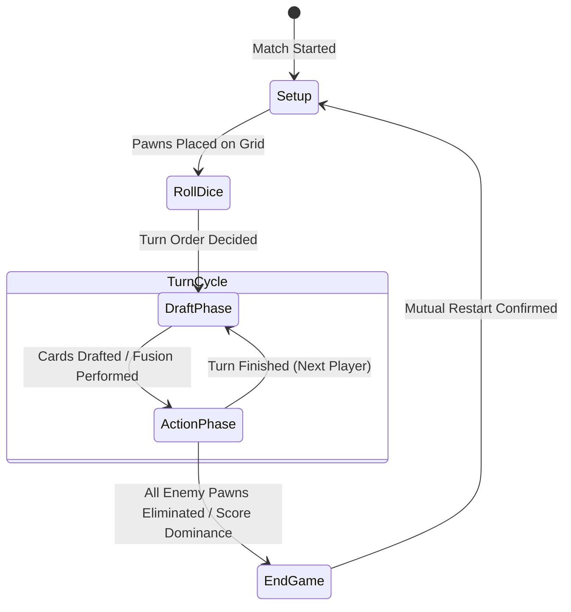

<div align="center">

<b>English</b> • <a href="README.tr.md">🇹🇷 Türkçe</a>

# ♟️ Modern Chess
### Tactical Hex-Grid Strategy & Deckbuilder

[](https://unity.com/)
[](https://docs.microsoft.com/en-us/dotnet/csharp/)
[](https://unity.com/products/netcode-for-gameobjects)
[](https://partner.steamgames.com/)
[](LICENSE)

<br />

**Modern Chess** is a competitive 3D tactical strategy game that combines traditional chess dynamics with a **10x11 hexagonal grid**, **dynamic card drafting and fusion mechanics**, **class synergies**, **autonomous heuristic bot AI**, and **Steamworks-powered multiplayer architecture**.

Built on **Unity 6 (Universal Render Pipeline)**, the project leverages a **Server-Authoritative Netcode for GameObjects (NGO)** architecture, Unity Relay/Lobby fallback services, direct Steam invite matchmaking, and runtime multi-language localization.

[Features](#-key-features) • [Game Loop](#-game-loop--turn-phases) • [Pawn & Class Roster](#-pawn-classes--combat-roles) • [System Architecture](#-software-architecture--design-patterns) • [AI & Telemetry](#-bot-ai--match-analytics) • [Getting Started](#-getting-started--installation)

</div>

---

## 🌟 Key Features

- **📐 10x11 Flat-Top Hexagonal Grid:**  
  Mathematically centered axial/odd-q offset coordinate mapping with cell occupancy tracking, dynamic obstacles, and raycast-based hex hover feedback.
- **🃏 Procedural Deck & Dynamic Buff/Debuff Affinity:**  
  Deterministic seed-based generation of a 120-card deck. Modular buff system scaling at 100% when matched with the pawn's class and 50% on class mismatches with alternative movement patterns.
- **⚗️ 3-Card Fusion & Re-Roll Mechanics:**  
  Card craft system enabling players to combine multiple hand cards into high-tier hybrid cards, accompanied by dice-based re-roll chances and animated 3D card flips.
- **🤝 Team Synergies & Radiating Aura Systems:**  
  Dynamic server-evaluated bonuses activated when threshold counts of specific pawn classes are alive on the board, alongside commander units radiating AoE stat auras.
- **🤖 Server-Authoritative Heuristic Bot AI:**  
  Autonomous artificial intelligence that weights board state, damage potential, and health scores (`PowerScore = Damage * 2 + HP * 1`) to make optimal Keep/Give/Burn card decisions.
- **📊 Automated XML Telemetry & Python Analytics CLI:**  
  Match logging system persisting end-game telemetry to `%LOCALAPPDATA%` in XML format, paired with a command-line analytics script (`analyze_reports.py`) for automated balance testing.
- **🌐 Hybrid Multiplayer (Unity NGO + Steamworks):**  
  Server-authoritative state synchronization preventing client-side tampering, combined with Facepunch.Steamworks lobby creation and Unity Relay code propagation.
- **🌍 5-Language Runtime Localization:**  
  Dynamic in-game language swapping (English, German, French, Portuguese, Spanish) driven by JSON data files and decoupled C# events.
- **🎨 Visual & Haptic Juice:**  
  Smooth DOTween micro-interactions, MoreMountains Feel & Lofelt NiceVibrations feedback, 3D dynamic cards, and tailored particle VFX.

---

## 🔄 Game Loop & Turn Phases

All match transitions are managed by the server-authoritative `GameManager` finite state machine (FSM):



1. **Setup Phase:** Both players select their pawn formations and place them within their respective deployment zones. Synergies are evaluated on placement.
2. **Roll Dice Phase:** The server generates a synchronized dice roll to determine initial turn initiative.
3. **Draft Phase:** Players draw 3 cards from the shared seeded deck and choose:
   - **Keep:** Add the card to your playable hand.
   - **Give:** Force the card onto the opponent (ideal for cards carrying severe debuffs or mismatched classes).
   - **Burn:** Permanently discard undesirable cards.
   - **Fusion:** Combine multiple hand cards to forge a more powerful hybrid card with re-roll options.
4. **Action Phase:** Players spend cards to move pawns, cast healing spells, place defensive obstacles (`ObstaclePattern`), and execute attacks.
5. **End Game Phase:** Triggered when a player's pawns are completely eliminated or the round limit is reached, declaring the victor and enabling a synchronized match restart.

---

## ♟️ Pawn Classes & Combat Roles

Every pawn is driven by a `PawnData` ScriptableObject defining combat stats, attack patterns, sounds, and visual effects:

| Class | Archetype | Damage | Health | Unique Capabilities & Strategy |
| :--- | :--- | :---: | :---: | :--- |
| **🏹 Archer** | Ranged Carry | Med | Med | Linear and angular ranged attack trajectories; creates safe-distance area denial. |
| **💣 Cannon** | Area of Effect (AoE) | High | Med | Explosive shell impacts with outward damage falloff over a defined radius. |
| **🛡️ Knight** | Frontline Tank | Med | High | High durability and choke-point blocking; protects high-value glass cannons. |
| **👑 Queen** | High-Mobility Threat | Very High | High | Broad multidirectional reach capable of threatening multiple lanes simultaneously. |
| **🐎 Horseman** | Flanking Cavalry | High | Med | Leaping movement pattern capable of bypassing obstacles and opposing pawns. |
| **🎖️ Commander** | Support & Aura Buffer | Med | High | Radiates a passive **+Damage** and **+Health** aura to all friendly units within a 2-cell radius. |
| **🥷 Ninja** | Infiltration Assassin | High | Low | Infiltrates backlines with agile leap steps to execute single high-priority targets. |
| **🤠 Cheriff** | Mid-Range Skirmisher | Balanced | Balanced | Versatile tactical response unit maintaining stable line control. |
| **🧙 Wizard** | Combat Healer | Low | Med | Regenerates health on wounded allies (**Heal**) while providing utility buffs. |

---

## 🏗️ Software Architecture & Design Patterns

The codebase is organized into cleanly decoupled modules following clean architecture and SOLID principles:

```
Assets/Scripts/
├── Grid/
│   ├── Core/                       # Combat calculations, Auras, Health, Localization
│   │   ├── AttackHandler.cs        # AoE falloff and attack resolution
│   │   ├── AuraManager.cs          # Passive radiant buff calculations
│   │   ├── PawnHealthController.cs # Floating health bars and damage indicators
│   │   └── LocalizationManager.cs  # 5-language JSON translation parser
│   ├── BotAIController.cs          # Server-side heuristic decision tree
│   ├── BotMatchReporter.cs         # XML telemetry logger
│   ├── DeckManager.cs              # Seeded 120-card deck & runtime buff injection
│   ├── DraftManager.cs             # Draft rounds & Keep/Give/Burn/Fusion RPCs
│   ├── FusionUI.cs                 # Card combination modal & DOTween card flips
│   ├── GameManager.cs              # Networked state machine (FSM)
│   ├── GridGenerator.cs            # 10x11 flat-top hex mathematical generator
│   ├── SynergyManager.cs           # Threshold class evaluation on server
│   └── TurnManager.cs              # Turn cycles, action clocks, and dice rolls
└── Multiplayer/
    ├── SteamManager.cs             # Facepunch.Steamworks lobby & invite handling
    ├── LobbyManager.cs             # Unity Relay / Lobby session integration
    └── NetworkBootstrap.cs        # Connection bootstrap and perspective controller
```

### Key Architectural Patterns:
- **Server-Authoritative State Machine:** Game state transitions, scores, card draws, and health values mutate solely on the host/server, synchronized across clients via `NetworkVariable` and `ClientRpc`.
- **ScriptableObject Data-Driven Architecture:** Pawns (`PawnData`), Movement Cards (`CardData`), and Buffs (`BuffData`) are decoupled data containers, allowing game designers to iterate without modifying runtime code.
- **Observer Pattern:** Decoupled C# events (`OnStateChanged`, `OnTurnChanged`, `OnLanguageChanged`) drive UI updates, sound triggers, and camera shifts without cyclic dependencies.
- **Assembly Definition Boundaries (`GameCore.asmdef`):** Optimizes compilation times and enforces strict dependency rules across Editor tools, Runtime logic, and Unit/PlayMode test suites.

---

## 🤖 Bot AI & Match Analytics

### Heuristic Decision Engine
`BotAIController` is a server-only component that enables singleplayer playtesting and automated game balancing:
- **Card Valuation:** Calculates class affinity scores. Positively aligned cards are prioritized for **Keep**, while debuffs or mismatched cards are passed via **Give** or destroyed via **Burn**.
- **Tactical Positioning:** Evaluates combat threat using a weighted power score (`DamageWeight = 2.0`, `HealthWeight = 1.0`), prioritizing vulnerable or high-threat enemy pawns.

### Automated Telemetry & Python CLI Tool
Every simulated AI match generates an XML report on the host machine:

```
%LOCALAPPDATA%Low/DefaultCompany/Project_Chess/BotVsBotReports/Report_[GameID].xml
```

The repository includes a root Python tool (`analyze_reports.py`) to parse match results and evaluate balance metrics:

```bash
# Analyze win rates and pawn selections from recent matches:
python analyze_reports.py
```

**Sample CLI Output:**
```text
Summary of latest 10 matches:
Player 1 Wins: 6 | Player 2 Wins: 4
Win Rate P1: 60.0% | Win Rate P2: 40.0%
Game 1042: Winner 1 (P1: Commander, Archer, Knight | P2: Wizard, Cannon, Ninja)
```

---

## 🌐 Multiplayer & Steamworks Integration

Modern Chess provides production-ready networking for both local testing and commercial distribution:

1. **Steamworks Lobby Matching (`SteamManager.cs`):**
   - When a host creates a lobby, a Unity Relay `JoinCode` is generated in the background.
   - The join code is automatically injected into the Steam Lobby metadata (`relay_code`).
   - Clients can join seamlessly via Steam Overlay friend invites or direct game joining without manual code entry.
2. **Dual-Client Testing via ParrelSync:**
   - Pre-configured with `com.veriorpies.parrelsync`.
   - Run two independent editor instances on a single machine for multiplayer debugging without building standalone binaries.

---

## 🌍 Localization Engine

Supported languages are parsed dynamically at runtime via `LocalizationManager` from `Assets/Resources/Localization/`:

| Code | Language | Source File |
| :---: | :--- | :--- |
| `EN` | English (Default) | `en.json` |
| `DE` | German | `de.json` |
| `FR` | French | `fr.json` |
| `PT` | Portuguese | `pt.json` |
| `ES` | Spanish | `es.json` |

UI labels subscribe to `LocalizationManager.OnLanguageChanged`, updating text components without reloading scenes.

---

## 🛠️ Tech Stack & Packages

| Category | Technology / Library | Version / Details |
| :--- | :--- | :--- |
| **Game Engine** | Unity Engine (URP) | `6000.2.7f2` |
| **Networking** | Netcode for GameObjects | `2.9.2` |
| **Transport** | Unity Transport | `2.6.0` |
| **Cloud Services** | Unity Relay & Lobby Services | `1.2.0 / 1.3.0` |
| **Platform Integration** | Facepunch.Steamworks | Steamworks API v1.5x |
| **Input System** | Unity Input System | `1.14.2` |
| **UI & Typography** | TextMeshPro & uGUI | `2.0.0` |
| **Animation Tweening** | DOTween (Demigiant) | Pro / v1.2+ |
| **Juice & Feel** | MoreMountains Feel & NiceVibrations | Lofelt Haptics |
| **Testing** | Unity Test Framework | EditMode & PlayMode Tests |

---

## 🚀 Getting Started & Installation

### Prerequisites
- **Unity Hub** with **Unity 6 (6000.2.7f2)** installed.
- **Git**
- *(Optional)* **Steam Client** (must be running in the background for Steam invite testing).
- *(Optional)* **Python 3.8+** (for match telemetry CLI).

### Step-by-Step Setup

1. **Clone the Repository:**
   ```bash
   git clone https://github.com/emirergn12/Modern_Chess.git
   ```

2. **Open with Unity Hub:**
   - Launch Unity Hub.
   - Click **Add > Add project from disk** and select the cloned project root.
   - Verify that the editor version is set to **6000.2.7f2**.

3. **Launch the Game Scene:**
   - Open `Assets/Scenes/MainMenu.unity`.
   - Press **Play (▶️)** in the Unity Editor.

4. **Multiplayer Testing with ParrelSync:**
   - Navigate to `ParrelSync > Clones Manager` in the top Unity menu bar.
   - Create a clone project and launch it alongside the primary editor.
   - Host from the primary editor and connect as a Client from the clone.

---

## 📄 License & Contributions

This project is open-source under the [MIT License](LICENSE). Contributions, bug reports, and suggestions are welcome:

1. Fork the Project (`fork`).
2. Create a Feature Branch (`git checkout -b feature/AmazingFeature`).
3. Commit your Changes (`git commit -m 'feat: Add AmazingFeature'`).
4. Push to the Branch (`git push origin feature/AmazingFeature`).
5. Open a **Pull Request**.

---

<div align="center">

### 👨‍💻 Developer
**Emir Ergün**  
[](https://github.com/emirergn12)

*Thank you for exploring Modern Chess! Enjoy the tactical battlefield! ♟️✨*

</div>
