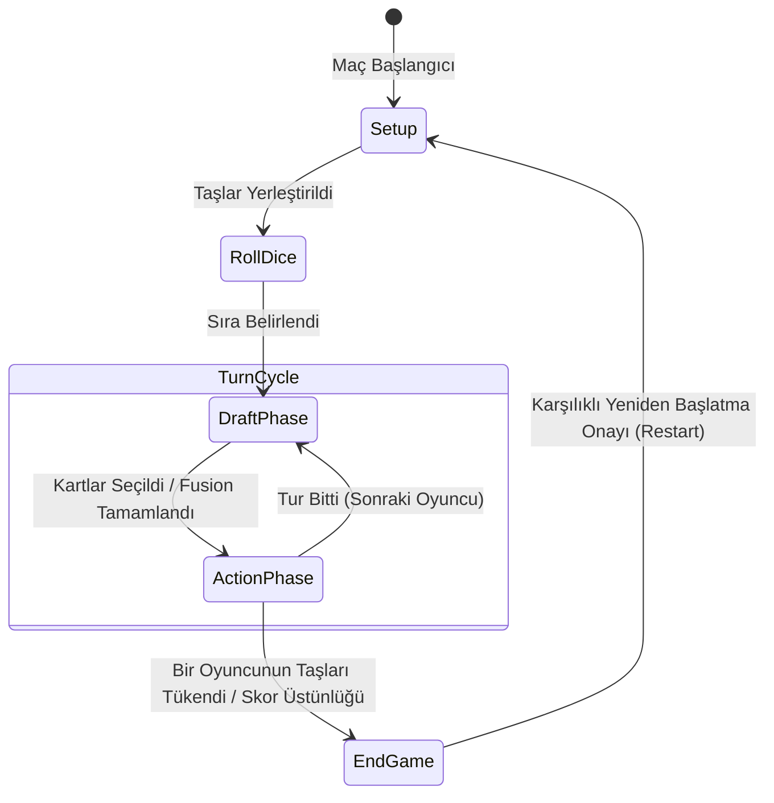

<div align="center">

<a href="README.md">🌐 Switch to English</a> • <b>🇹🇷 Türkçe</b>

# ♟️ Modern Chess
### Taktiksel Altıgen Izgara Strateji & Deste Oluşturma Oyunu

[](https://unity.com/)
[](https://docs.microsoft.com/en-us/dotnet/csharp/)
[](https://unity.com/products/netcode-for-gameobjects)
[](https://partner.steamgames.com/)
[](LICENSE)

<br />

**Modern Chess**, klasik satranç mekaniklerini altıgen (hexagonal) taktiksel alan kontrolü, dinamik kart draft ve birleştirme (fusion) mekanikleri, sınıf tabanlı sinerji bonusları ve yapay zeka simülasyonları ile buluşturan **üç boyutlu, rekabetçi bir taktik strateji oyunudur.**

Unity 6 motoru ve Universal Render Pipeline (URP) ile geliştirilen proje; **Server-Authoritative Netcode for GameObjects** mimarisi, **Steamworks Lobi & Arkadaş Daveti entegrasyonu**, **Heuristic Bot AI** karar mekanizmaları ve çoklu dil desteğiyle sektör standartlarında bir yazılım mimarisi sunar.

[Özellikler](#-öne-çıkan-özellikler) • [Oyun Akışı](#-oyun-döngüsü-ve-evreler) • [Taş & Sınıf Tablosu](#-taş-pawn-ve-sınıf-sistemi) • [Sistem Mimarisi](#-yazılım-mimarisi-ve-tasarım-desenleri) • [Yapay Zeka & Telemetri](#-yapay-zeka-ve-maç-analiz-sistemi) • [Kurulum](#-kurulum-ve-çalıştırma)

</div>

---

## 🌟 Öne Çıkan Özellikler

- **📐 10x11 Düz-Üst (Flat-Top) Altıgen Izgara:**  
  Aksiyal/Odd-Q koordinat hesabı ile matematiksel olarak kusursuz yerleştirilen harita, hücre bazlı yol bulma, dinamik engelleme ve alan kontrolü.
- **🃏 Prosedürel Deste & Dinamik Buff/Debuff Sistemi:**  
  Seed tabanlı deterministik 120 kartlık deste üretimi. Kartların taş sınıfları ile eşleşmesine göre tam (%100) veya uyumsuz (%50) etki gösteren modüler buff sistemi.
- **⚗️ Kart Birleştirme (Fusion & Re-Roll) Mekaniği:**  
  Oyuncuların ellerindeki kartları birleştirerek üst seviye hibrit kartlar türetebildiği, zar tabanlı yeniden çekme (Re-roll) destekli craft sistemi.
- **🤝 Takım Sinerjisi ve Aura Dinamikleri:**  
  Aynı sınıf/gruptan taşların tahtadaki sayısına göre tüm müttefiklere tetiklenen takım bonusları ve komutan taşlarının yaydığı alan (Aura) etkileri.
- **🤖 Server-Authoritative Gelişmiş Bot AI:**  
  Tahta durumunu, taş sağlığını ve hasar potansiyelini ağırlıklı güç formülüyle puanlayan (`PowerScore`), Keep/Give/Burn kararlarını otonom alan yapay zeka.
- **📊 Otomatik XML Maç Raporlama ve Python Analiz CLI:**  
  Bot vs Bot maçlarının tüm hamle, saldırı ve kazanan verilerini `%LOCALAPPDATA%` dizinine XML olarak kaydeden telemetri sistemi ve maç dengesini analiz eden Python aracı (`analyze_reports.py`).
- **🌐 Hibrit Çok Oyunculu Mimari (Unity Relay + Steamworks):**  
  İstemci manipülasyonlarını engelleyen sunucu onaylı ağ mimarisi, Unity Lobby/Relay entegrasyonu ve Steam arkadaşlarını doğrudan odaya davet edebilme desteği.
- **🌍 5 Farklı Dil Desteği (Runtime Localization):**  
  İngilizce, Almanca, Fransızca, Portekizce ve İspanyolca dillerinde çalışma anında dinamik dil değişimi sağlayan JSON tabanlı yerelleştirme mimarisi.
- **🎨 Premium Görsel ve İşitsel Geri Bildirim:**  
  DOTween mikro-animasyonları, MoreMountains Feel & Lofelt NiceVibrations haptik/görsel geribildirimleri, 3D dinamik kart modelleri ve parçacık sistemleri.

---

## 🔄 Oyun Döngüsü ve Evreler

Oyun mantığı, `GameManager` durum makinesi (FSM) üzerinden sunucu yetkisinde 5 temel evrede yürütülür:



1. **Setup Phase (Hazırlık Evresi):** Oyuncular stratejilerine göre taş seçimlerini tamamlar ve belirlenen başlangıç hücrelerine yerleştirir. Sinerji kuralları ilk kez hesaplanır.
2. **Roll Dice Phase (Zar Atışı):** Ağ üzerinden senkronize zar atışı yapılarak ilk turu oynayacak taraf belirlenir.
3. **Draft Phase (Kart Çekim & Seçim):** Desteden çekilen 3 kart arasından oyuncu taktiksel kararını verir:
   - **Keep (Sakla):** Kartı eline alır.
   - **Give (Rakibe Ver):** Kartı bilerek rakibe devreder (özellikle zararlı debuff içeren veya kendi taşlarına uymayan kartlar için).
   - **Burn (Yak):** Kartı tamamen yok eder.
   - **Fusion (Birleştir):** Eldeki birden fazla kartı eritip daha güçlü yeni bir kart türetir.
4. **Action Phase (Aksiyon & Hamle):** Kartlar oynanarak taşlar hareket ettirilir, engeller (`ObstaclePattern`) yerleştirilir ve menzilli/yakın saldırılar icra edilir.
5. **End Game Phase (Oyun Sonu):** Bir oyuncunun tüm taşları elendiğinde veya belirlenen tur limitine ulaşıldığında puan üstünlüğüne göre kazanan ilan edilir.

---

## ♟️ Taş (Pawn) ve Sınıf Sistemi

Her taş sınıfı, `PawnData` ScriptableObject mimarisiyle tanımlanmış bağımsız saldırı kalıplarına, can havuzuna ve özel yeteneklere sahiptir:

| Taş Sınıfı | Rol / Tip | Hasar | Can | Özel Yetenek & Taktiksel Rol |
| :--- | :--- | :---: | :---: | :--- |
| **🏹 Archer** | Menzilli Saldırı | Orta | Orta | Doğrusal ve açısal menzilli saldırı kalıbı; güvenli mesafeden baskı kurar. |
| **💣 Cannon** | Alan Hasarı (AoE) | Yüksek | Orta | Çarpma noktasından dışa doğru azalan (Damage Falloff) alan patlaması yaratır. |
| **🛡️ Knight** | Ön Hat Tankı | Orta | Yüksek | Yüksek dayanıklılık ve dar boğaz savunması için kritik hat koruyucusu. |
| **👑 Queen** | Taktiksel Saldırgan | Çok Yüksek | Yüksek | Tahtanın büyük bölümünü tehdit eden çok yönlü geniş hareket kapasitesi. |
| **🐎 Horseman** | Mobil Süvari | Yüksek | Orta | Engellerin ve taşların üzerinden atlayabilen esnek L/altıgen manevra yeteneği. |
| **🎖️ Commander** | Destek & Aura | Orta | Yüksek | Çevresindeki 2 birim yarıçapındaki tüm müttefiklere pasif **+Hasar** ve **+Can** aurası yayar. |
| **🥷 Ninja** | Suikastçı | Yüksek | Düşük | Düşman hatlarının arkasına sızma ve yüksek anlık tek hedef hasarı. |
| **🤠 Cheriff** | Alan Kontrolü | Dengeli | Dengeli | Orta mesafe kontrolü ve stabil hasar dağılımı. |
| **🧙 Wizard** | Şifacı / Destek | Düşük | Orta | Müttefik birimlerin canını yenileyen **Heal** yeteneği ve alan destek büyüleri. |

---

## 🏗️ Yazılım Mimarisi ve Tasarım Desenleri

Proje, genişletilebilir ve temiz kod (Clean Code) prensiplerine uygun olarak modüler bir şekilde tasarlanmıştır:

```
Assets/Scripts/
├── Grid/
│   ├── Core/                       # Çekirdek mekanikler (Hasar, Sağlık, Auralar, Yerelleştirme)
│   │   ├── AttackHandler.cs        # AoE, menzil ve vuruş hesaplamaları
│   │   ├── AuraManager.cs          # Komutan ve alan buff hesaplayıcısı
│   │   ├── PawnHealthController.cs # Can barları ve hasar görselleştirmesi
│   │   └── LocalizationManager.cs  # 5 dilli JSON çeviri yöneticisi
│   ├── BotAIController.cs          # Sunucu taraflı otonom karar motoru
│   ├── BotMatchReporter.cs         # XML telemetri ve loglama servisi
│   ├── DeckManager.cs              # 120 kartlık prosedürel deste & runtime buff enjeksiyonu
│   ├── DraftManager.cs             # Draft turu, Keep/Give/Burn/Fusion durumları
│   ├── FusionUI.cs                 # Kart birleştirme arayüzü ve DOTween animasyonları
│   ├── GameManager.cs              # Ağ senkronize oyun durum makinesi (FSM)
│   ├── GridGenerator.cs            # 10x11 Flat-top altıgen ızgara matematik motoru
│   ├── SynergyManager.cs           # Sınıf eşleşme ve takım bonus yöneticisi
│   └── TurnManager.cs              # Tur sıralaması, süre sayaçları ve zar atışları
└── Multiplayer/
    ├── SteamManager.cs             # Facepunch.Steamworks lobi & davet entegrasyonu
    ├── LobbyManager.cs             # Unity Relay / Lobby oturum yönetimi
    └── NetworkBootstrap.cs        # Ağ başlatıcı ve istemci perspektif kontrolü
```

### Kullanılan Başlıca Tasarım Desenleri:
- **Server-Authoritative State Machine:** Oyunun tüm durumları (`GameState`, puanlar, can değerleri, kart havuzları) sadece sunucu üzerinde mutasyona uğrar; istemcilere `NetworkVariable` ve `ClientRpc` aracılığıyla replike edilir.
- **ScriptableObject Data-Driven Architecture:** Taşlar (`PawnData`), Kartlar (`CardData`) ve Güçlendirmeler (`BuffData`) koddan bağımsız veri nesneleri olarak yönetilir. Tasarımcılar kod değiştirmeden yeni taş/kart üretebilir.
- **Observer Pattern (Olay Güdümlü Tasarım):** `OnStateChanged`, `OnTurnChanged`, `OnLanguageChanged` gibi C# `Action` eventleri sayesinde UI ve ses sistemleri çekirdek oyun kodundan tamamen izole çalışır.
- **Assembly Definition (`GameCore.asmdef`):** Kod tabanı derleme sürelerini minimize etmek ve `PlayModeTests` / `EditModeTests` test ortamlarıyla temiz bağımlılıklar kurmak için modüllere ayrılmıştır.

---

## 🤖 Yapay Zeka ve Maç Analiz Sistemi

### Heuristic Bot Karar Mekanizması
`BotAIController`, sunucu üzerinde çalışan ve insan oyuncunun hareketlerini simüle eden otonom bir yapay zekadır:
- **Kart Değerlendirme:** Elindeki kartın sınıf uyumunu kontrol eder. Kendi taşlarına %100 uyan pozitif kartları **Keep** yapar; uymayan veya debuff içeren kartları stratejik olarak **Give** veya **Burn** yapar.
- **Pozisyonel Değerleme:** Saldırı menzilindeki hedefleri `DamageWeight (2.0)` ve `HealthWeight (1.0)` çarpanlarıyla puanlayarak en yüksek tehdit oluşturan düşman taşlarına yönelir.

### Otomatik Telemetri ve Python Analiz Aracı
Yapay zeka maçları tamamlandığında oyun motoru otomatik olarak bir XML raporu üretir:

```
%LOCALAPPDATA%Low/DefaultCompany/Project_Chess/BotVsBotReports/Report_[GameID].xml
```

Kök dizinde bulunan `analyze_reports.py` betiği ile maç dengesi ve taş kazanma oranları anında konsolda listelenebilir:

```bash
# Son 10 maçın kazanma oranlarını ve taş tercihlerini analiz edin:
python analyze_reports.py
```

**Örnek Analiz Çıktısı:**
```text
Summary of latest 10 matches:
Player 1 Wins: 6 | Player 2 Wins: 4
Win Rate P1: 60.0% | Win Rate P2: 40.0%
Game 1042: Winner 1 (P1: Commander, Archer, Knight | P2: Wizard, Cannon, Ninja)
```

---

## 🌐 Çok Oyunculu Altyapı ve Steam Entegrasyonu

Modern Chess, hem geliştirme aşamasında lokal testleri hem de oyuncular için canlı Steam bağlantısını destekler:

1. **Steam Lobi Entegrasyonu (`SteamManager.cs`):**
   - Host oyuncu lobi açtığında arka planda Unity Relay servisi üzerinden bir `JoinCode` üretilir.
   - Bu kod otomatik olarak Steam Lobi meta-verisine (`relay_code`) kaydedilir.
   - İstemci oyuncu Steam arayüzünden doğrudan **"Oyuna Katıl"** diyerek veya arkadaş davetine tıklayarak lobiye bağlanabilir.
2. **Çift İstemci Testi (ParrelSync):**
   - Proje `com.veriorpies.parrelsync` paketini içerir.
   - Tek bir bilgisayarda projeyi derlemeden iki ayrı Unity Editör penceresi açarak çok oyunculu senaryolar saniyeler içinde test edilebilir.

---

## 🌍 Çoklu Dil Desteği (Localization)

`LocalizationManager`, `Assets/Resources/Localization/` klasöründeki JSON dosyaları üzerinden 5 dili destekler:

| Kod | Dil | Dosya |
| :---: | :--- | :--- |
| `EN` | İngilizce (Varsayılan) | `en.json` |
| `DE` | Almanca | `de.json` |
| `FR` | Fransızca | `fr.json` |
| `PT` | Portekizce | `pt.json` |
| `ES` | İspanyolca | `es.json` |

Dil değişikliği yapıldığında tüm UI elemanları sahneyi yeniden yüklemeye gerek kalmadan anında güncellenir.

---

## 🛠️ Teknoloji Yığını ve Kütüphaneler

| Kategori | Teknoloji / Kütüphane | Sürüm / Detay |
| :--- | :--- | :--- |
| **Oyun Motoru** | Unity Engine (URP) | `6000.2.7f2` |
| **Ağ / Çok Oyunculu** | Netcode for GameObjects | `2.9.2` |
| **Ağ Taşıma Katmanı** | Unity Transport | `2.6.0` |
| **Bulut Servisleri** | Unity Relay & Lobby Services | `1.2.0 / 1.3.0` |
| **Platform API** | Facepunch.Steamworks | Steamworks v1.5x |
| **Girdi Sistemi** | Unity Input System | `1.14.2` |
| **Arayüz & Tipografi** | TextMeshPro & Unity UI | `2.0.0` |
| **Animasyon Motoru** | DOTween (Demigiant) | Pro / v1.2+ |
| **Görsel / Haptik Geri Bildirim** | MoreMountains Feel & NiceVibrations | Lofelt Haptics |
| **Test & Kalite** | Unity Test Framework | EditMode & PlayMode Tests |

---

## 🚀 Kurulum ve Çalıştırma

### Gereksinimler
- **Unity Hub** ve **Unity 6 (6000.2.7f2)** editörü.
- **Git**
- *(İsteğe Bağlı)* **Steam Masaüstü İstemcisi** (Steam çok oyunculu özellikleri için arka planda açık olmalıdır).
- *(İsteğe Bağlı)* **Python 3.8+** (Maç istatistik analizleri için).

### Adım Adım Kurulum

1. **Repoyu Klonlayın:**
   ```bash
   git clone https://github.com/emirergn12/Modern_Chess.git
   ```

2. **Unity Hub'a Ekleyin:**
   - Unity Hub uygulamasını açın.
   - **Add > Add project from disk** seçeneğine tıklayın ve klonladığınız klasörü seçin.
   - Editör sürümü olarak **Unity 6000.2.7f2** seçildiğinden emin olun.

3. **Oyunu Başlatın:**
   - Proje açıldıktan sonra `Assets/Scenes/MainMenu.unity` sahnesine çift tıklayın.
   - Unity Editöründe **Play (▶️)** butonuna basın.

4. **Lokal Multiplayer Testi (ParrelSync ile):**
   - Üst menüden `ParrelSync > Clones Manager` penceresini açın.
   - **Create new clone** ile bağımsız bir kopya editör oluşturun.
   - Ana editörde Host, klon editörde Client olarak bağlanıp maç yapabilirsiniz.

---

## 📄 Lisans ve Katkıda Bulunma

Bu proje açık kaynaklı olup [MIT Lisansı](LICENSE) altında geliştirilmektedir. Katkıda bulunmak için:

1. Bu depoyu Fork'layın (`fork`).
2. Yeni özellik dalı açın (`git checkout -b feature/YeniOzellik`).
3. Değişikliklerinizi kaydedin (`git commit -m 'feat: Yeni özellik eklendi'`).
4. Dalınıza gönderin (`git push origin feature/YeniOzellik`).
5. Bir **Pull Request** oluşturun.

---

<div align="center">

### 👨‍💻 Geliştirici
**Emir Ergün**  
[](https://github.com/emirergn12)

*Modern Chess projesini incelediğiniz için teşekkür ederiz! Strateji dolu oyunlar! ♟️✨*

</div>
